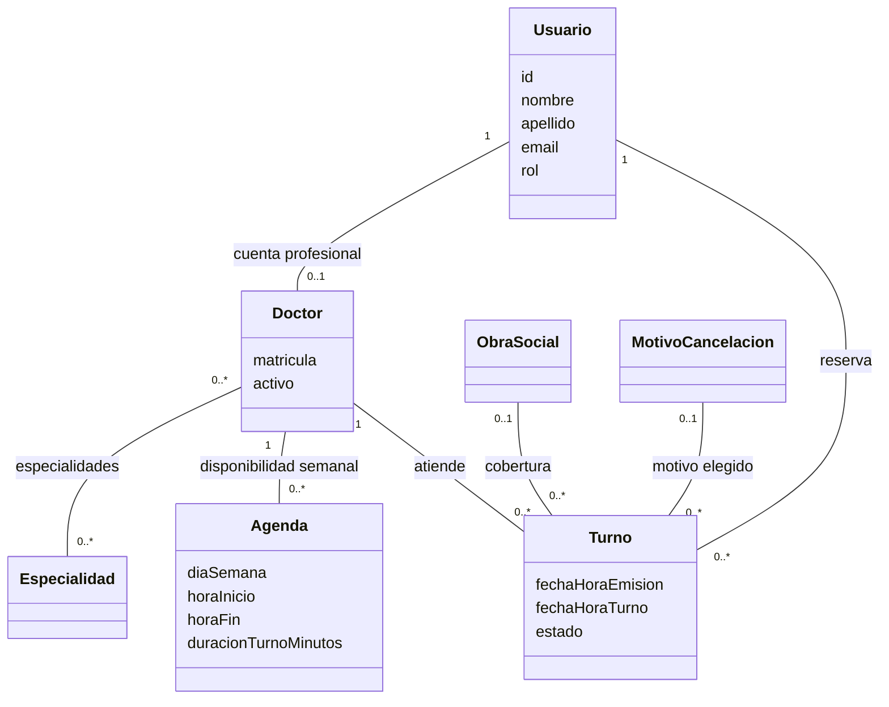

# Propuesta TP DSW — Hospital Ripper

## Grupo

### Integrante

- **52288 — Gobbo, Facundo.**

El trabajo se realiza individualmente con autorización docente, según lo informado por el alumno. Para esta propuesta se adopta un alcance equivalente a dos integrantes, por decisión del alumno. La autorización para trabajar solo no se presenta como una aprobación docente de esta actualización del alcance.

### Repositorio

- [Aplicación full stack](https://github.com/Gibi01/TP-dsw-2026).
- Código del [frontend](../frontend-dsw/) y del [backend](../backend-dsw/).
- PR/MR de entrega: pendiente de incorporar.

## Tema

### Descripción

Hospital Ripper es un sistema de gestión de turnos para un sanatorio.
Los pacientes consultan especialidades y profesionales, eligen un horario disponible y reservan su atención.
Los médicos administran sus agendas y registran la asistencia de los pacientes.
El administrador mantiene los profesionales y los catálogos necesarios para operar el sistema.

### Tecnologías

Frontend en React y TypeScript con Vite y Material UI. Backend en Express y TypeScript, con persistencia en MySQL mediante MikroORM. Better Auth administra la autenticación; la aplicación utiliza roles de paciente, médico y administrador.

### Modelo

Modelo de dominio basado en las entidades actuales. Cada turno corresponde a un usuario en calidad de paciente; un médico también posee una cuenta de usuario. Obra social y motivo preestablecido son opcionales en el turno.

Las sesiones y cuentas de autenticación y la cola técnica de notificaciones no se representan como catálogos de negocio. El modelo no incluye una entidad Sanatorio: se gestiona un único establecimiento.

## Alcance funcional

### Alcance mínimo: 

| Requisito | Funcionalidad seleccionada |
| --- | --- |
| CRUDs simples | Especialidades y obras sociales. |
| Un CRUD dependiente | Agenda, asociada a un médico. |
| Un listado filtrado con detalle | Profesionales por nombre o especialidad, con acceso a la ficha del médico y sus horarios. |
| Un caso de uso de negocio | CU-01: reservar un turno. |

### Adicionales para aprobación

Se incluye la gestión de las clases de negocio necesarias: Especialidad, ObraSocial, MotivoCancelacion, Doctor, Agenda, Usuario y Turno. El estado de sus operaciones se detalla en la [matriz](matriz-cumplimiento.md); su inclusión aquí no significa que estén todas terminadas.

Se seleccionan dos casos de uso relacionados: **CU-01 reservar un turno** y **CU-02 registrar la asistencia**. CU-02 utiliza el turno generado por CU-01, por lo que la relación no depende de contabilizar dos variantes de una misma reserva.

#### CU-01 — Reservar un turno

- **Actor:** usuario autenticado que solicita atención.
- **Precondiciones:** médico activo, agenda configurada y horario futuro disponible.
- **Flujo:** consultar profesionales o especialidades; elegir fecha y horario; seleccionar cobertura cuando corresponda; confirmar la reserva.
- **Resultado:** turno pendiente asociado al paciente y al médico, consultable en el historial del paciente y en el listado de atención del médico.
- **Alternativas:** solicitar inicio de sesión; rechazar horarios fuera de agenda, pasados u ocupados; informar errores de reserva.
- **Pendiente conocido:** garantizar que dos solicitudes simultáneas no reserven el mismo horario.

#### CU-02 — Registrar la asistencia de un turno

- **Actor:** médico asignado al turno.
- **Precondiciones:** sesión de médico y turno pendiente propio, sujeto a las restricciones temporales del sistema.
- **Flujo:** consultar los turnos a atender, identificar al paciente y registrar asistencia o inasistencia.
- **Resultado:** el turno pasa a asistido o no asistido y conserva su vinculación con paciente y profesional.
- **Alternativas:** rechazar acciones sobre turnos de otro médico o estados incompatibles.
- **Relación:** consume el registro creado en CU-01.

### Funcionalidades complementarias

- Cancelación de reservas por el paciente y consulta del historial.
- Gestión de motivos de cancelación.
- Alta, edición y baja lógica de profesionales.
- Consulta administrativa de usuarios por nombre, rol, estado y antigüedad.
- Selección de iconos para especialidades.
- Exploración de disponibilidad por especialidad como variante de CU-01.
- Procesamiento automático de inasistencias y notificaciones, cuya operación depende de configuración y verificación.

La recuperación de contraseña no se presenta como una función terminada: su integración estaba pendiente en la revisión inicial.

## Condiciones de cierre

Antes de presentar esta propuesta como cumplida se deben resolver los pendientes de la matriz, verificar los flujos y completar los entregables. La cancelación se propone como baja funcional del turno, conservando su historial; su aceptación como parte del CRUD debe confirmarse en la revisión del alcance con el docente.

Referencia: [enunciado y requisitos funcionales](https://github.com/utnfrrodsw/tp#32-requisitos-funcionales). Estructura adaptada de la [plantilla de propuesta](https://github.com/utnfrrodsw/tp/blob/main/proposal.md).
